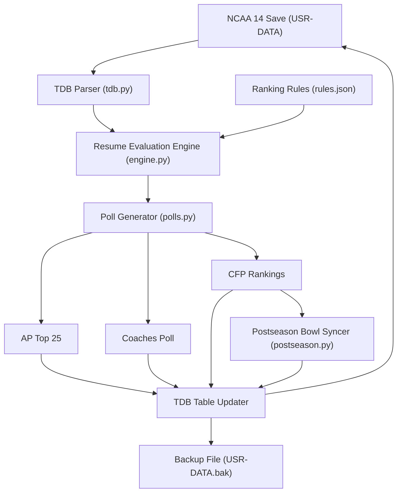

# NCAA Dynasty Rerank

`ncaa-dynasty-rerank` is a command-line tool and Python library that calculates and applies custom college football rankings to NCAA Football 14 dynasty save files (`USR-DATA`).

## What the Tool Does

When you advance a week in an NCAA Football 14 dynasty on the RPCS3 emulator, the in-game polls are computed using default EA formulas. `ncaa-dynasty-rerank` reads the completed schedule and team records directly from the unencrypted save binary, evaluates teams using configurable resume metrics, and writes updated ranks and points back into the save file:

1. **College Football Playoff (CFP / BCS) Rankings**: Re-ranks the Top 25 (stored in field `TBRK`) based on resume quality, strength of schedule, quality wins, and head-to-head results.
2. **Associated Press (AP) Top 25 Poll**: Generates authentic media poll point distributions (stored in fields `APRK`, `APPO`, `APFP`, `APPR`).
3. **USA Today Coaches Poll**: Generates authentic coaches poll point distributions and incorporates poll inertia (stored in fields `CPRK`, `CPPO`, `CPFP`, `CPPR`).
4. **Postseason Bowl Synchronization**: During bowl season, detects the BCS National Championship Game in the schedule (`SCHD`) and aligns it to match CFP #1 vs CFP #2, relocating displaced conference champions into vacated major bowl slots.

## How It Works

## Save File Safety

Before writing any modifications to a save file, the tool:

- Prompts for confirmation showing a side-by-side preview of proposed rank changes and bowl adjustments.
- Creates an automatic, timestamped backup copy (`USR-DATA.bak.<timestamp>`) in the same directory.
- Recalculates EA big-endian CRC-32 table checksums to ensure RPCS3 loads the save without data corruption errors.
