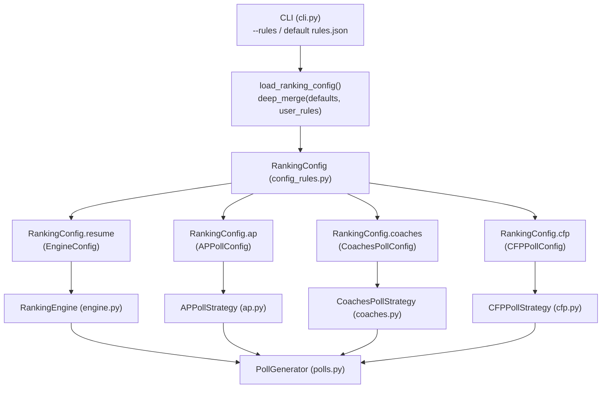

# Customizable Ranking Rules Configuration Implementation Plan

> **For agentic workers:** REQUIRED SUB-SKILL: Use superpowers:subagent-driven-development (recommended) or superpowers:executing-plans to implement this plan task-by-task. Steps use checkbox (`- [ ]`) syntax for tracking.

**Goal:** Extract all hardcoded resume, AP, Coaches, and CFP ranking variables and weights into a unified Pydantic configuration hierarchy that loads and deep-merges user-defined rules from a configuration file (`~/.config/ncaa-dynasty-rerank/rules.json` or `--rules <path>`) over authentic defaults.

**Architecture:** Introduce structured sub-models (`EngineConfig`, `APPollConfig`, `CoachesPollConfig`, `CFPPollConfig`) combined under `RankingConfig`. Provide recursive deep-merge loading so users only need to specify the parameters they wish to override. Wire configuration injection through `RankingEngine`, `PollStrategy` subclasses, `PollRegistry`, `PollGenerator`, and `cli.py` with dedicated `rules` CLI management subcommands (`export`, `show`, `validate`, `path`).

**Tech Stack:** Python 3.10+, Pydantic v2, Rich, pytest.

---

## User Review Required

> [!IMPORTANT]
> **Configuration File Location and Merge Semantics:**
> - **Default user rules path:** `~/.config/ncaa-dynasty-rerank/rules.json` (alongside `config.json`).
> - **Partial Overrides (Deep Merge):** Users do **not** need to copy the entire configuration to change a single value. Any keys present in `rules.json` (or passed via `--rules`) overwrite the defaults; missing keys retain default college football ranking values.
> - **Conference Weights & Bluebloods:** Overriding conference weights merges key-by-key (e.g. updating only conference `11` to `1.20` preserves all other 12 conferences). Overriding list/set fields (e.g. `blueblood_tgids`) replaces the list with the user-provided array.

---

## Proposed Changes

---

### Task 1: Configuration Models and Deep Merge Loader

**Files:**
- Modify: `src/ncaa_dynasty_rerank/config_rules.py`
- Modify: `src/ncaa_dynasty_rerank/config.py`
- Create: `tests/test_config_rules.py`

**Interfaces:**
- Consumes: Pydantic `BaseModel`, `Field`
- Produces: `RankingConfig`, `APPollConfig`, `CoachesPollConfig`, `CFPPollConfig`, `deep_merge()`, `load_ranking_config()`, `export_default_ranking_config()`

- [ ] **Step 1: Write failing tests for config models, deep merge, and partial overrides**
- [ ] **Step 2: Run pytest to verify tests fail**
- [ ] **Step 3: Implement config models, deep merge, and loader functions in `config_rules.py` and `config.py`**
- [ ] **Step 4: Run pytest to verify tests pass**
- [ ] **Step 5: Commit changes**

---

### Task 2: RankingEngine Parameterization

**Files:**
- Modify: `src/ncaa_dynasty_rerank/engine.py`
- Modify: `tests/test_engine.py`

**Interfaces:**
- Consumes: `EngineConfig`, `RankingConfig` from `config_rules.py`
- Produces: Fully parameterized `RankingEngine` methods reading dynamic weights from `self.config`

- [ ] **Step 1: Write failing test in `test_engine.py` asserting custom conference blend, quality caps, and unplayed baseline variables work**
- [ ] **Step 2: Run pytest to verify test fails**
- [ ] **Step 3: Update `RankingEngine` to use all fields from `self.config` without any residual hardcoded numbers**
- [ ] **Step 4: Run pytest to verify all engine tests pass**
- [ ] **Step 5: Commit changes**

---

### Task 3: Strategy Parameterization and Registry Injection

**Files:**
- Modify: `src/ncaa_dynasty_rerank/strategies/ap.py`
- Modify: `src/ncaa_dynasty_rerank/strategies/coaches.py`
- Modify: `src/ncaa_dynasty_rerank/strategies/cfp.py`
- Modify: `src/ncaa_dynasty_rerank/strategies/registry.py`
- Modify: `src/ncaa_dynasty_rerank/polls.py`
- Create: `tests/test_custom_rules_integration.py`

**Interfaces:**
- Consumes: `APPollConfig`, `CoachesPollConfig`, `CFPPollConfig`, `RankingConfig`
- Produces: Parameterized strategy rankers and registry factory accepting `RankingConfig`

- [ ] **Step 1: Write failing integration test verifying custom poll configs (custom AP win bonus, custom Coaches anchor, H2H toggles) alter ranking outputs**
- [ ] **Step 2: Run pytest to verify test fails**
- [ ] **Step 3: Update `APPollStrategy`, `CoachesPollStrategy`, `CFPPollStrategy`, `PollRegistry`, and `PollGenerator` to accept and use respective configs**
- [ ] **Step 4: Run pytest to verify integration tests pass**
- [ ] **Step 5: Commit changes**

---

### Task 4: CLI `--rules` Flag and `rules` Management Subcommands

**Files:**
- Modify: `src/ncaa_dynasty_rerank/cli.py`
- Modify: `tests/test_cli.py`

**Interfaces:**
- Consumes: `load_ranking_config`, `export_default_ranking_config`, `ConfigManager`
- Produces: CLI `-r/--rules` option, `rules show`, `rules export`, `rules validate`, `rules path` subcommands

- [ ] **Step 1: Write tests for CLI rules subcommands and `--rules` reranking flag in `test_cli.py`**
- [ ] **Step 2: Run pytest to verify tests fail**
- [ ] **Step 3: Implement CLI changes in `cli.py`**
- [ ] **Step 4: Run pytest to verify tests pass**
- [ ] **Step 5: Commit changes**

---

### Task 5: Full Suite Verification & Documentation

**Files:**
- Modify: `README.md`

- [ ] **Step 1: Update README.md documenting `rules.json`, `--rules` flag, and customizing ranking parameters**
- [ ] **Step 2: Run full test suite with `uv run pytest`**
- [ ] **Step 3: Run linter with `uv run ruff check`**
- [ ] **Step 4: Commit changes**
